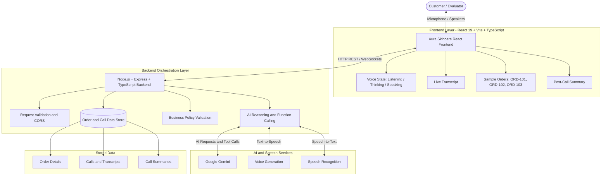

# Aura Skincare — AI Voice Customer Support Agent (Aria)

An enterprise-grade, browser-based AI voice customer support web application built for **Aura Skincare**, a premium organic Indian skincare brand. The conversational AI assistant, **Aria**, communicates with customers through natural voice interaction, verified database lookups, deterministic policy enforcement, real-time transcription, and automated post-call summarization.

---

## 🌿 Live Application Access

- **Public Deployed URL:** `https://aria-customer-care-8472.ai.studio/`
- **Shared Production Link:** `https://aria-customer-care-8472.ai.studio/`
- **Application Title:** Aura Skincare | AI Voice Support
- **AI Voice Persona:** Aria (Warm, friendly Indian English skincare specialist)
- **Status:** Production Ready (33 Automated Tests Passing)

---

## ✨ Project Overview & Key Features

- **Real Voice Interaction:** Natural voice conversations via browser microphone (`Web Audio API` / `SpeechRecognition`) with voice playback powered by Gemini Speech Synthesis (`gemini-3.8-flash-lite-tts`) with Indian English cadence and browser fallback.
- **Dynamic Voice State Machine:** Seamless UI transitions across `Idle` ➔ `Connecting` ➔ `Listening` ➔ `Thinking` ➔ `Speaking` ➔ `Ended`.
- **Verified Backend Database:** Live query and status mutations on seeded sample orders (`ORD-101`, `ORD-102`, `ORD-103`).
- **Strict Deterministic Policy Enforcement:**
  - **Shipping:** Strictly above ₹499 is Free; ₹499 or below incurs a ₹50 shipping fee; 3–5 business days delivery.
  - **Returns:** 7-day post-delivery return window; product must be unopened and in original sealed packaging.
  - **Defective / Damaged:** Reported within 48 hours of delivery with photo evidence for replacement.
  - **Cancellations:** Permitted exclusively while live order status is `Processing`. Doorstep refusal available for `Shipped` or `Out for Delivery`.
  - **Cash on Delivery (COD):** Available up to ₹2,500 with doorstep Cash or UPI payment.
- **Post-Call Structured Summarization:** Automatic generation and storage of validated JSON summaries detailing `customer_intent`, `order_id`, `resolution_status`, `call_summary`, and `escalation_required`.
- **Persistent Call History:** Searchable transcript history, duration timers, tool call timelines, and copyable JSON summaries.
- **Zero Assessment References:** Public portal presents exclusively as Aura Skincare's customer care portal with luxury warm ivory (`#FAF7F2`) and botanical sage green (`#2D5A35`) aesthetics.

---

## 🏛 System Architecture



---

## 🧪 Automated Test Results

```text
========================================
  AURA SKINCARE TEST SUITE EXECUTION   
========================================

--- 1. Sample Order Lookups ---
  ✓ PASS: ORD-101 retrieval matches Priya Sharma, BlueDart, Out for Delivery
  ✓ PASS: ORD-102 retrieval matches Rahul Verma, Delivered, ₹499
  ✓ PASS: ORD-103 retrieval matches Ananya Patel, Processing, ₹850

--- 2. Invalid & Missing Order IDs ---
  ✓ PASS: ORD-999 lookup fails gracefully with error message
  ✓ PASS: Missing order_id fails gracefully

--- 3. Shipping Policy Boundaries ---
  ✓ PASS: Strictly-above-₹499 rule: Exactly ₹499 incurs ₹50 shipping fee
  ✓ PASS: Order of ₹500 qualifies for free delivery
  ✓ PASS: Order of ₹699 qualifies for free delivery

--- 4. Cash on Delivery Boundaries ---
  ✓ PASS: COD of ₹2,000 is eligible
  ✓ PASS: Boundary check: COD of exactly ₹2,500 is eligible
  ✓ PASS: COD above ₹2,500 (₹2,501) is ineligible

--- 5. Return & Refund Policy Boundaries ---
  ✓ PASS: Boundary check: Exactly 7 days unopened is eligible for return
  ✓ PASS: 8 days post-delivery is rejected (exceeds 7-day window)
  ✓ PASS: Sunscreen received 14 days ago and opened (ORD-102 scenario) is strictly rejected
  ✓ PASS: Boundary check: Damaged reported within 48h with photos is eligible for replacement
  ✓ PASS: Damaged reported at 49h (exceeding 48h window) is rejected
  ✓ PASS: Damaged reported within window without photos requires photos before approval

--- 6. Cancellation Eligibility & Operations ---
  ✓ PASS: Order in Processing status is eligible for cancellation
  ✓ PASS: Out for Delivery cannot be cancelled in system; doorstep refusal allowed
  ✓ PASS: cancel_order executes successfully on Processing order ORD-103
  ✓ PASS: ORD-103 status mutated in database to Cancelled
  ✓ PASS: cancel_order refuses to cancel Out for Delivery order ORD-101

--- 7. AI Scenario Verification ---
  ✓ PASS: Scenario: Where is order ORD-101? Aria retrieves BlueDart and Out for Delivery
  ✓ PASS: Scenario: Track ORD-999 asks customer to verify ID
  ✓ PASS: Scenario: Flight to Goa is politely redirected to Aura Skincare customer care
  ✓ PASS: Scenario: Ambiguous "help me with my order" asks for the specific order ID
  ✓ PASS: Scenario: How much is delivery? explains ₹50 fee and free shipping above ₹499
  ✓ PASS: Scenario: COD for ₹2,000 confirmed within ₹2,500 limit

--- 8. Call Lifecycle, Transcripts & Summaries ---
  ✓ PASS: Call created with active status and ID
  ✓ PASS: Transcript chronologically stores entries
  ✓ PASS: Call summary extracts ORDER_TRACKING and ORD-101
  ✓ PASS: Call finalized with completed status and resolution_status RESOLVED
  ✓ PASS: Finalizing call is idempotent

========================================
  RESULTS: 33 PASSED, 0 FAILED
========================================
```

---

## 💻 Windows PowerShell Setup & Local Development

### 1. Configure Environment Variables
```powershell
Copy-Item .env.example .env
```

### 2. Install Dependencies
```powershell
npm install
```

### 3. Run Automated Tests
```powershell
npm run test
```

### 4. Launch Full-Stack Server
```powershell
npm run dev
```
Open your browser at `http://localhost:3000`.

---

## 💬 Technical Evaluation & Architecture Q&A

### 1. Why did you choose this tech stack?

I used React, TypeScript, Express, Vite, and Google Gemini to build the application. React helps create the user interface, while Express handles backend requests. TypeScript helps catch coding errors, and Vite makes development faster. Using TypeScript for both the frontend and backend also makes it easier to connect different parts of the application.

### 2. What was the most difficult technical part, and how did you solve it?

The most difficult part was managing the voice conversation smoothly. I had to handle microphone permissions, understand the user's speech, process requests, and play the agent's voice without interruptions. I solved this by creating different states for the agent, such as listening, thinking, and speaking. I also added a backup option using the browser's speech feature if the main voice system fails.

### 3. What would you improve with another week of development?

With one more week, I would focus on three improvements:

- **Better voice conversations:** Make conversations more natural and allow users to interrupt the agent while it is speaking.
- **WhatsApp integration:** Send call summaries and allow customers to share photos of damaged products through WhatsApp.
- **Database improvements:** Use PostgreSQL to store orders and conversation details more reliably.

### 4. What would you change if the system handled 1,000 customer conversations per day?

If the system handled 1,000 conversations daily, I would make these improvements:

- **Better session management:** Use Redis to manage active conversations and their data more efficiently.
- **Faster voice responses:** Save commonly used voice responses so they can be played quickly without generating them every time.
- **Background task processing:** Use a queue system to handle tasks such as generating call summaries separately, so they do not slow down ongoing conversations.

---

## 📹 Demo Video Script (3–5 Minutes)

- **[0:00 - 0:45] Introduction & Branding:**
  *"Welcome to Aura Skincare's AI Voice Customer Support portal. Aura Skincare is a premium organic Indian brand, and I am demonstrating Aria, our real-time voice assistant."*
- **[0:45 - 1:30] Live Order Tracking (ORD-101):**
  *Click 'Start Voice Call'. Say: 'Where is order ORD-101?'*
  *Aria executes `get_order_details('ORD-101')`, announces Priya Sharma's Vitamin C Serum, BlueDart courier, and delivery scheduled by 6 PM today.*
- **[1:30 - 2:15] Order Cancellation & Database Mutation (ORD-103 vs ORD-101):**
  *Say: 'Can I cancel order ORD-101?'*
  *Aria verifies that ORD-101 is Out for Delivery, refuses system cancellation per policy, and informs the user about doorstep refusal.*
  *Say: 'Cancel order ORD-103'. Aria confirms it is in Processing status, executes `cancel_order`, and updates the status to Cancelled.*
- **[2:15 - 3:00] Return Policy & Shipping Boundaries:**
  *Say: 'I received my sunscreen 14 days ago and opened it. Can I return it?'*
  *Aria validates that 14 days exceeds the 7-day return window and that opened items cannot be accepted for hygiene reasons.*
  *Say: 'How much is delivery for an order worth ₹499?'*
  *Aria enforces the strictly-above-₹499 rule: exactly ₹499 incurs the ₹50 fee; above ₹499 qualifies for free delivery.*
- **[3:00 - 3:45] Post-Call Analysis & Structured JSON Summary:**
  *Click 'End Call'. Inspect the automatically generated Post-Call Summary modal with verified Customer Intent, Order ID, Resolution Status, Executive Summary, and Tool Trace.*
- **[3:45 - 4:00] Wrap-up:**
  *Highlight the 33/33 passing automated test suite and clean standalone branding.*
